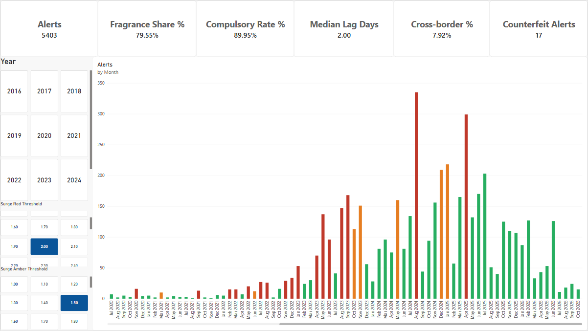
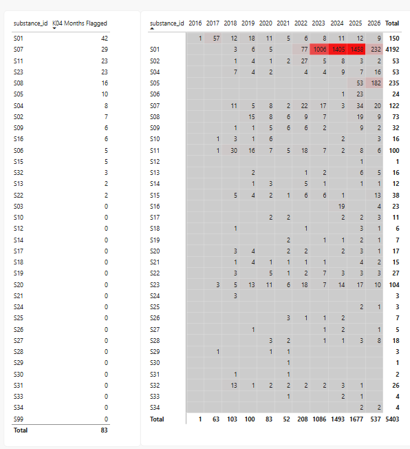
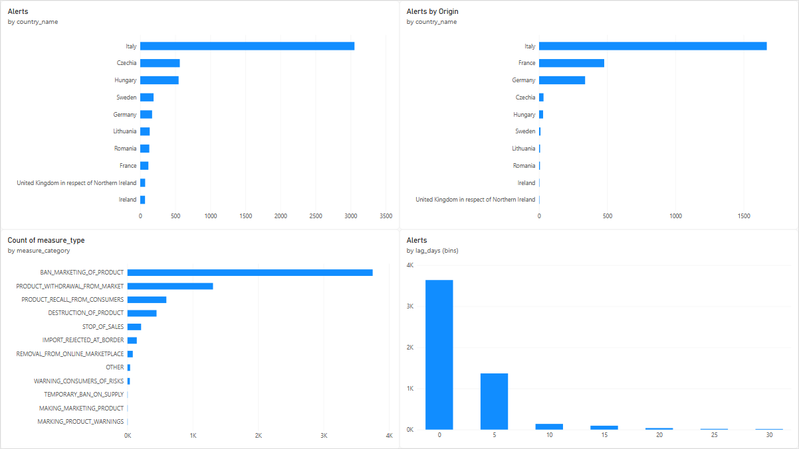

# EU Cosmetics Safety Gate: a regulatory risk monitor

Excel · Power Query · Power BI · DAX | Eshwar Arunkumar Vimala

## Executive summary

**A ban date doesn't end regulatory risk in cosmetics. It starts a recall tail that lasts two to three years.** I analysed every EU Safety Gate cosmetics alert from 2016 to October 2026 (5,403 alerts, 6,638 enforcement measures). Three findings matter for any brand owner:

1. **The risk peaks long after the rule changes.** BMHCA was banned in March 2022. 72% of its alerts were published two or more years later, at a median of 31 months.
2. **The exposure is concentrated.** One substance accounts for 77% of all alerts, and about 80% involve a fragrance ingredient. The 2028 allergen-labelling deadline lands on the same category.
3. **The next wave can be seen early, but only with the right indicator.** TPO in gel nail polish set off this monitor's emerging-substance flag in November 2025, seven months before alerts for it peaked. Ranking substances by alert volume would have missed it.

The deliverable is a monitor with ten KRIs, built in Excel and Power BI and reconciled between the two. It puts these signals on one page every month.


*Exhibit 1. KRI overview: monthly alerts coloured by surge status against their trailing 12-month average. Source: European Commission Safety Gate; author analysis.*

## 1. The recall burden arrives two to three years after the ban

BMHCA ("lilial"), a fragrance ingredient, was moved to Annex II of Regulation (EC) 1223/2009 with effect from 1 March 2022. Alerts didn't peak that year. They peaked in 2024 (1,405) and 2025 (1,457), as products already on the market kept turning up in inspections.

A company that treated the effective date as the finish line had its heaviest recall and withdrawal load two years later. The compliance deadline and the commercial exposure are separate events, and they need separate plans.

## 2. Exposure is concentrated in one substance and one category

BMHCA is the primary substance in 4,175 of the 5,403 alerts (77%). Across all substances, about 80% of alerts involve a fragrance ingredient, and perfumes, eaux de toilette and body sprays make up roughly 40% of alerts by product type.

For a fragrance-led portfolio, a single formulation decision can drive most of its regulatory exposure. The extended allergen-labelling rule becomes mandatory on 31 July 2028 and falls on exactly this category.

## 3. The next wave is detectable early, but volume rankings miss it

TPO, used in gel nail polish, was banned on 1 September 2025 with no sell-through period. It went from 3 alerts in October 2025 to 96 in June 2026. On a volume ranking it looked minor until mid-2026, because BMHCA's scale dwarfs everything else.

The emerging-substance KRI (K04) compares each substance with its own history, not with the whole market. It flagged TPO in November 2025. Over the full ten years the flag fired in 83 substance-months across 15 substances. It is selective enough to act on.

| Substance | Months flagged | Read |
| --- | --- | --- |
| S01 BMHCA | 42 | Long-running emergence |
| S07 | 29 | Persistent secondary |
| S11 | 23 | Persistent secondary |
| S23 | 23 | Persistent secondary |
| **S05 TPO** | **10** | **First flagged Nov 2025, 7 months before peak** |



*Exhibit 2. Substance watch: alerts by substance and year (left) with K04 months flagged (right). Right-clicking any substance drills through to the underlying official alerts. Source: European Commission Safety Gate; author analysis.*

## 4. Country data measures enforcement intensity, not where the risk comes from

Italy files 3,055 alerts (56.5% of the total) but is named as the country of origin in roughly half as many. France and Germany are the opposite: each is the origin of more alerts than it files. Authorities enforce at very different intensities, and 90% of alerts lead to at least one compulsory measure.

A rise in one country's notifications says more about its inspectors than its manufacturers. Read the country numbers as a map of enforcement before drawing conclusions about sourcing.


*Exhibit 3. Markets and enforcement: notifying vs origin country, measure mix, and notification lag. Source: European Commission Safety Gate; author analysis.*

## Recommendations

| # | Action | Why | What to track |
| --- | --- | --- | --- |
| 1 | Run every Annex II or III change as a three-year exposure programme, with stock sell-down and withdrawal plans in place before the effective date | The tail peaks two to three years after the ban | K01 and K06 for the affected substance, monthly for 36 months |
| 2 | Add the emerging-substance flag to the monthly risk review. When it fires, check formulation and artwork for that substance within 30 days | Volume rankings found TPO about seven months after K04 did | K04 status, time from flag to review |
| 3 | Start the 2028 allergen-labelling programme now and prioritise fragrance SKUs | Fragrance carries about 80% of current exposure | Share of fragrance SKUs with compliant labels |
| 4 | Treat country-level changes in notifications as enforcement signals before acting on sourcing | Notifying country and origin country differ sharply | Alerts by notifying vs origin country |

## Appendix

### A. Approach

The pipeline was built in three layers, and each layer was checked against the one before it.

- **Power Query:** typed load (barcode kept as text, UTF-8 encoding, dates), product-type cleaning that cut 542 raw values to 511, a split of risk types into rows, merges for notifying and origin country, and lag columns. A single file-path parameter drives the whole load.
- **Excel:** keyword-based substance classification, product-family rules applied in priority order, compulsory-measure and recall flags taken from the measures table, and a monthly K01–K10 tracker with RAG thresholds the user can edit.
- **Power BI:** a six-table star schema with a marked date table and role-playing country dimensions (USERELATIONSHIP), plus time-intelligence measures (YoY, YTD, rolling 12 months, trailing 12-month surge ratio). It also holds the K04 flag, a what-if parameter for retuning the RAG thresholds live, and three report pages with drill-through to the official alert pages.

### B. Reconciliation

Each headline figure was built separately in Excel and in Power BI, and the two match exactly.

| Check | Excel | Power BI |
| --- | --- | --- |
| Total alerts | 5,403 | 5,403 |
| Fragrance share, 2025 | 87.6% | 87.6% |
| Alerts with a compulsory measure | 4,860 | 4,860 |
| Rolling 12-month alerts, Sep 2026 | 864 | 864 |
| Surge ratio, Jan 2023 | 3.06 | 3.06 |

The full data-quality and reconciliation log is in `docs/data_quality_log.md`.

### C. KRI definitions

| KRI | Definition |
| --- | --- |
| K01 | Alerts published per month |
| K02 | This month ÷ average month of the prior 12 (surge) |
| K03 | Share of alerts naming a fragrance ingredient |
| K04 | Emerging substance: trailing 3-month count above 2× its prior monthly average, minimum 5 |
| K05 | Share of alerts with at least one compulsory measure |
| K06 | Share of alerts with a recall or withdrawal (write-off proxy) |
| K07 | Median days from notification to publication |
| K08 | Share of alerts where other countries reacted |
| K09 | Online share of alerts with a known sales channel |
| K10 | Counterfeit alerts |

### D. Data

5,403 alerts and 6,638 measures from the European Commission's [Safety Gate](https://ec.europa.eu/safety-gate-alerts/) public API, pulled on 16 October 2026 and covering 2016 to October 2026. Reuse is permitted with attribution. Reference tables are in `data/reference`, and every column is documented in `docs/DATA_DICTIONARY.md`. To refresh the data, run `python scripts/fetch_safety_gate.py` and then `python scripts/classify_alerts.py`.

### E. Limitations

- **Safety Gate records what authorities inspected, not total market risk.** Notification counts carry each country's enforcement intensity.
- **Substances are classified by keyword on the published risk description (about 99% coverage).** When an alert names several substances, the first match is taken as the primary one.
- **Some fields are often missing.** Country of origin is unknown for 12% of alerts and sales channel for 82%. K09 therefore uses known-channel alerts only.
- **The alerts record labelling and formulation breaches, not measured harm to consumers.**
- **Alert reference codes change from A12 to SR in December 2024,** when GPSR replaced GPSD. The legal basis changed; the severity of alerts did not.
- **K07 uses the median lag (2 days), not the mean.** A small number of records carry creation dates up to 1,729 days old, which would distort a mean.

### F. Repository

```
data/       raw · reference · processed
scripts/    data pull and reference classification
excel/	    P1_SafetyGate_Analysis.xlsx
powerbi/    P1_SafetyGate.pbix · screenshots/
docs/       DATA_DICTIONARY.md · POWER_BI_BUILD_GUIDE.md · data_quality_log.md · notes.md
```

### G. Authorship

The Power Query transformations, Excel analysis, Power BI model, DAX measures and report are my own work. AI helped write the data-pull scripts in `/scripts`, the lookup tables in `/data/reference`, and the classified dataset in `/data/processed`. I used that dataset only as an answer key to check my results.
